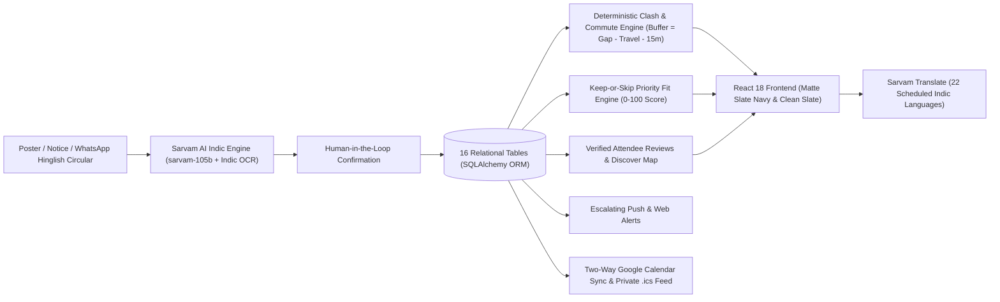

# Eventure

[](https://python.org)
[](https://flask.palletsprojects.com/)
[](https://react.dev/)
[](https://vitejs.dev/)
[](https://sarvam.ai)
[](#3-check-it-works)
[](LICENSE)

> **"Every campus event, in one intelligent thread. Powered by Sarvam AI Indic Intelligence."**

Built with pride by **Team Quanta** for **hackFront India Grand Finale (IIIT Delhi, 21–22 Nov 2026)**:
- **Manav Setia** — Backend Architecture & Core Systems
- **Mayank Sharma** — API Engineering & External Integrations

---

## National Market Scale (AISHE Benchmark)

Eventure is engineered for the sheer scale of the Indian Higher Education ecosystem, benchmarked against the **Ministry of Education AISHE (All India Survey on Higher Education)** findings:

- **4.50 Crore (45 Million)** Enrolled Higher Education Students across India.
- **1,289 Universities & Institutes of National Importance** (IITs, IIITs, NITs, Central & State Universities).
- **48,246 Affiliated Colleges** hosting thousands of hackathons, fests, and cultural events every semester.

Campus communication is fragmented across unstructured WhatsApp forwards, Unstop links, Devfolio portals, and university notice boards. Eventure provides the single intelligent, multi-lingual thread that turns chaos into a prioritized roadmap.

---

## System Architecture



### 16 Relational Tables (SQLAlchemy ORM)
1. `users` — Student profiles, campus geolocation, career goals, and custom scoring mode.
2. `events` — Canonical campus competitions, categories, venues, and registration URLs.
3. `user_events` — Individual student journeys, stages, submission notes, and custom score overrides.
4. `stages` — Multi-round milestones (Abstract, PPT, Prototype, Finals) with due dates.
5. `exam_periods` — Student semester exam datesheets for the Academic Shield clash detector.
6. `reviews` — Anti-tamper peer reviews restricted strictly to verified attendees.
7. `clubs` — College societies, technical chapters, and student clubs.
8. `club_follows` — Student-to-club subscription mappings.
9. `teams` — Hackathon squads with unique 6-character team join codes.
10. `team_members` — Squad rosters syncing timeline stages across teammates.
11. `inbox_items` — Forwarded emails with Sarvam-parsed structured drafts.
12. `google_accounts` — OAuth tokens for two-way Google Calendar synchronization.
13. `synced_items` — Cross-references between Eventure stages and external Google events.
14. `push_subscriptions` — RFC 8291 / 8292 VAPID Web Push endpoints.
15. `notifications` — In-app alerts, deadline reminders, and conflict warnings.
16. `tracked_portals` — User-selected platforms (Unstop, Devfolio, MLH) with auto-sync watchers.

---

## Getting Started

### Prerequisites
- **Python 3.11+**
- **Node.js 18+**

---

### 1. Backend Setup

Open a terminal (PowerShell on Windows):

```powershell
cd backend
python -m venv .venv
.venv\Scripts\activate
# (On macOS/Linux: source .venv/bin/activate)

pip install -r requirements.txt
copy .env.example .env
# (On macOS/Linux: cp .env.example .env)

# Seed realistic Delhi NCR campus demo data:
python seed.py --reset

# Start the Flask backend server:
python run.py
```

The backend server starts at **`http://localhost:5000`**.
*(Zero-API-key fallback: Eventure runs 100% locally with built-in deterministic rules and offline Haversine commute estimation even without external API keys).*

---

### 2. Frontend Setup

In a new terminal window:

```powershell
cd frontend
npm install

# Option A: Start Vite development server (hot-reload on port 5173):
npm run dev

# Option B: Build production bundle (Flask directly serves static assets):
npm run build
```

Open **`http://localhost:5000`** (or `http://localhost:5173` if running Vite dev server).

**Demo Credentials:**
- **Student A (AI/Hackathon Profile -> Score 82):**
  - Email: `demo@eventure.app`
  - Password: `demo1234`
- **Student B (Design Profile -> Score 20):**
  - Email: `student2@eventure.app`
  - Password: `demo1234`

---

### 3. Check It Works (110 Automated Tests)

#### Backend Test Suite (92 tests):

```powershell
cd backend
python -m unittest discover -s tests -v
# or using pytest:
pytest tests -v
```

**92 automated tests** verify:
- Deterministic clash radar (direct overlaps, commute travel gaps, exam shields, personal calendars)
- Algorithmic priority fit scoring (0–100) and keep-or-skip recommendations across tuning modes
- Tracked portals watcher CRUD, automatic sync status, and platform affinity ranking boost
- OCR preprocessing pipeline (greyscale, adaptive upscaling, binarization) and error recovery
- Security rate limiting, RFC 7518 JWT validation, and live REST endpoints

#### Frontend Test Suite (18 tests):

```powershell
cd frontend
npm test
```

**18 automated tests** run via Vitest across:
- Date & range formatting (same-day, multi-day, fallback handling)
- Relative time & deadline calculations (`timeLeft`, `timeAgo`)
- Travel duration formatting and sanity caps
- API client authentication flow, token storage, 401 auto-logout, and file uploads

---

## Core Capabilities

| Feature | Description |
|---|---|
| **Sarvam Indic Intelligence** | Powered by `sarvam-105b` chat completions and Sarvam Indic Document OCR for extracting milestones from Hinglish flyers and WhatsApp circulars. |
| **Indic Multilingual UI** | 1-click language switcher powered by `Sarvam Translate` supporting Hindi, Bengali, Tamil, Telugu, and Marathi. |
| **Priority Fit Score (0–100)** | Algorithmic scoring with student-customizable tuning presets (Balanced, Interest-first, Deadline-first, Nearby-first) and transparent mathematical breakdown tooltip. |
| **Inline Priority Editing** | Interactive score badge allowing students to override and prioritize hackathons according to personal focus. |
| **Deterministic Clash Radar** | Highlights schedule overlaps, transit gaps (`Buffer = Gap - Travel Time - 15m`), and university exam conflicts with 1-click resolution actions. |
| **Hackathon Submission Vault** | Pre-deadline toolkit storing GitHub repo, live demo, slides, demo video, and tech stack tags with a 1-click **"Copy All Links"** button. |
| **Automated Portal Tracker** | Watcher panel for major hackathon platforms (Unstop, Devfolio, MLH, Campus portals) with automated sync toggles. |
| **Verified Attendee Reviews** | Anti-tamper review system accepting ratings only from students confirmed to have attended after the event start date. |
| **Discover Map** | Interactive Leaflet campus map showing nearby hackathons with Bayesian-smoothed ratings and commute distances. |
| **Two-Way Calendar Sync** | Direct Google Calendar sync and private `.ics` feed for Apple Calendar, Outlook, and mobile widgets. |

---

## Docker Deployment

For containerized deployment with PostgreSQL:

```bash
docker compose up -d --build
```

---

## License

This project is licensed under the MIT License — see the [LICENSE](LICENSE) file for details. Built with pride by Team Quanta for hackFront India 2026.
