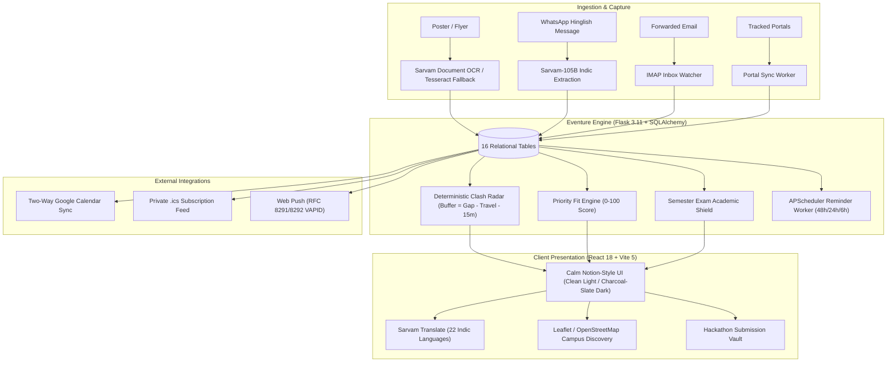

# Eventure

[](https://python.org)
[](https://flask.palletsprojects.com/)
[](https://react.dev/)
[](https://vitejs.dev/)
[](https://sarvam.ai)
[](#-automated-testing--verification-110-tests)
[](LICENSE)

> **"Every event, one thread."**  
> *One place to discover campus events, choose what matters, track every round and learn from the outcome.*

Built with pride by **Team Quanta** for **hackFront India 2026** (Grand Finale · IIIT Delhi · Open Innovation):
- **Manav Setia**
- **Mayank Sharma**
- **Milan Sharma**
- **Arjun Singh**
- **Aryan Rai**

---

## 📌 Executive Summary

> *“Students don’t miss opportunities due to lack of talent. They miss them because campus communication is broken.”*

In a typical university week, opportunities are scattered across posters, WhatsApp group forwards, Discord servers, and portal listings. Critical registration deadlines expire silently, travel commute gaps make attending consecutive events impossible, and semester sessionals collide with hackathon finals.

**A calendar sees one dot on one date. Eventure sees the whole connected chain.**

---

## 📊 National Scale & Market Impact (AISHE Benchmark)

Eventure is designed for the sheer scale of the Indian Higher Education ecosystem, benchmarked against official **AISHE (All India Survey on Higher Education)** findings:

- **4.50 Crore (45 Million)** Enrolled Higher Education Students across India.
- **1,289 Universities & Institutes of National Importance** (IITs, IIITs, NITs, Central & State Universities).
- **48,246 Affiliated Colleges** hosting thousands of hackathons, symposiums, and cultural fests every semester.
- **45 min → 3 min**: Drastic reduction in weekly student event-search and deadline-tracking overhead.
- **3 Escalating Reminders**: 48 h, 24 h, and 6 h safety alerts before every submission gate.
- **1-Click Submission**: Instant export of all project artifacts from the Submission Vault.

---

## 🎯 10 Features Across Five Stages

```
   [01. DISCOVER]  ───>  [02. DECIDE]  ───>  [03. TRACK]  ───>  [04. CLASH CHECK]  ───>  [05. REVIEW]
   • Smart Capture       • Keep or Skip      • Stage Timeline    • Clash Radar          • Verified Reviews
   • Discover Map        • Clubs & Teams     • Smart Reminders   • Submission Vault     • Portal Tracker
```

| # | Stage | Feature | Description |
|---|---|---|---|
| **01** | **Discover** | **Smart Capture** | Turn raw posters and Hinglish WhatsApp forwards into ready-to-review event drafts via Sarvam-105B & Document OCR. |
| **02** | **Track** | **Stage Timeline** | Follow every round, stage deadline (Abstract, PPT, Prototype, Finals), and travel window in a unified thread. |
| **03** | **Clash Check** | **Clash Radar** | Deterministic detection for overlapping hours, tight commute buffers, and university exam period shields. |
| **04** | **Decide** | **Keep or Skip (0–100)** | Transparent algorithmic priority fit scoring with customizable Keep cut-off thresholds (50, 55, 62). |
| **05** | **Discover** | **Discover Map** | Interactive Leaflet campus map showing nearby hackathons with Bayesian-smoothed ratings and travel distance. |
| **06** | **Review** | **Verified Reviews** | Anti-tamper peer ratings and feedback restricted exclusively to students marked as `attended` on their timeline. |
| **07** | **Track** | **Smart Reminders** | Escalating notifications firing at 48 h (Heads up), 24 h (Urgent), and 6 h (Critical) before cutoff gates. |
| **08** | **Decide** | **Clubs & Teams** | Collaborative squad rosters with 6-character team join codes syncing timeline stages across squadmates. |
| **09** | **Clash Check** | **Submission Vault** | Centralized pre-deadline hub storing GitHub repo, demo URL, presentation deck, video, and 1-click **"Copy All Links"**. |
| **10** | **Review** | **Portal Tracker** | Live monitoring for major hackathon aggregators (Unstop, Devfolio, Hack2skill) with automated deadline sync. |

---

## ⚡ Deterministic Clash Radar: Mathematical Spec

Rather than opaque heuristics, Eventure computes commute viability using hard arithmetic:

$$\text{Buffer} = \text{Commute Gap} - \text{Road Travel Time} - \text{15 min Safety Buffer}$$

### Worked Example:
- **Workshop Y**: Ends at 4:00 PM (Campus A)
- **Hackathon X**: Starts at 4:45 PM (Campus B)
- **Commute Gap**: 45 minutes
- **Real Road Travel Time**: 40 minutes (offline Haversine / Google Distance Matrix)
- **Safety Buffer**: 15 minutes

$$\text{Buffer} = 45 - 40 - 15 = -10\text{ minutes}$$

$$\text{Negative Buffer } (-10\text{ min}) \implies \mathbf{CRITICAL\ TRAVEL\ GAP\ WARNING}$$

The student receives an actionable recommendation: *"Keep Hackathon X. Mark Workshop Y as skipped."*

---

## 🎯 Priority Fit Scoring Engine (0–100)

| Factor | Default Weight | Description |
|---|---|---|
| **Interest & Career Alignment** | **40 pts** | Keyword matching against student career goals (AI, Web3, Systems, Design). |
| **Deadline Urgency** | **20 pts** | Proximity to the immediate submission gate or registration cutoff. |
| **Commute Proximity** | **20 pts** | Road travel time from pinned college campus coordinates. |
| **Registered Status** | **10 pts** | Bonus for events the student has already committed to. |
| **Goal Track Fit** | **10 pts** | Match with specific track interests (e.g. Open Innovation, EdTech). |
| **Exam Period Penalty** | **-25 pts** | Deducted automatically if the event overlaps semester exam dates. |

### Keep / Skip Decision Threshold:
- **Default Cut-off**: **55+**
- **Student Controls**: Configurable in Settings between **50+**, **55+**, and **62+**.
- **Student A (AI in profile)**: $40 + 12 + 20 + 0 + 10 = \mathbf{82} \implies \mathbf{KEEP}$
- **Student B (Design profile)**: $0 + 12 + 8 + 0 + 0 = \mathbf{20} \implies \mathbf{SKIP}$

---

## 🆚 Product Capability Comparison

| Student Need | Unstop | Google Calendar | Tracathon | **Eventure (Team Quanta)** |
|---|---|---|---|---|
| **Find Opportunities** | Public listings + filters | Not its main purpose | Hackathon tracker; no broad feed | **Campus map + nearby events + portal watcher** |
| **Track Each Stage** | Dates on listing page | Generic dated events | Stage-by-stage hackathon timeline | **One connected thread for all rounds & submissions** |
| **Reminders** | Organiser updates | Custom notifications | In-app + email reminders | **Escalating 48 h, 24 h, and 6 h risk-based alerts** |
| **Personal Fit & Clashes** | Manual listing comparison | Calendar availability | Priority dashboard for deadlines | **0–100 Fit score + Travel buffer radar + Exam shield** |
| **Submission Toolkit** | Form inputs per listing | None | None | **Submission Vault with 1-click "Copy All Links"** |
| **After-Event Learning** | Organiser feedback | Not a review product | Participation insights | **Verified Attendee-only peer reviews (Anti-spam)** |
| **Indic Multilingual** | English only | Standard localization | English only | **Sarvam Translate across 22+ Scheduled Languages** |

---

## 🏗️ System Architecture & Services



### 12 Backend Micro-Services:
1. `extraction` — Normalization and stage breakdown for unstructured circulars.
2. `ocr` — Image preprocessing (adaptive upscaling, greyscale, binarization) + Sarvam Vision OCR.
3. `sarvam_ai` — Sarvam-105B chat completion client, Document OCR, and 22-language translation.
4. `conflicts` — Deterministic clash radar (temporal overlaps, travel buffer gap calculations).
5. `priority` — Algorithmic 0–100 score engine supporting customizable tuning modes.
6. `travel` — Road distance computation with Google Distance Matrix & offline Haversine fallback.
7. `inbox` — Forwarded email circular parsing and conversion into ready event drafts.
8. `imap_poll` — Automated mailbox polling worker.
9. `reminders` — Escalating notification scheduling (48 h, 24 h, 6 h).
10. `push` — VAPID Web Push alert delivery.
11. `google_calendar` — OAuth 2.0 two-way event synchronization.
12. `ics` — RFC 5545 calendar feed generation for Apple Calendar, Outlook, and mobile devices.

---

## 🚀 Getting Started

### Prerequisites:
- **Python 3.11+**
- **Node.js 18+**

---

### 1. Backend Setup

```powershell
cd backend
python -m venv .venv
.venv\Scripts\activate
# (On macOS/Linux: source .venv/bin/activate)

pip install -r requirements.txt
copy .env.example .env
# (On macOS/Linux: cp .env.example .env)

# Seed realistic Delhi NCR campus demo data:
python seed.py --reset

# Start the Flask backend server:
python run.py
```

Backend starts at: **`http://localhost:5000`**  
*(Zero-API-key fallback: Eventure runs 100% locally with built-in deterministic rules and offline Haversine commute estimation even without external API keys).*

---

### 2. Frontend Setup

```powershell
cd frontend
npm install

# Start development server with hot-reload:
npm run dev

# Or build production bundle (Flask serves static assets):
npm run build
```

Open: **`http://localhost:5173`** (or `http://localhost:5000` if serving via Flask).

#### Demo Accounts:
- **Student A (AI/Hackathon Focus → Score 82):**
  - Email: `demo@eventure.app`
  - Password: `demo1234`
- **Student B (Design Profile → Score 20):**
  - Email: `student2@eventure.app`
  - Password: `demo1234`

---

## 🧪 Automated Testing & Verification (110 Tests)

### Backend Test Suite (92 Tests):
```powershell
cd backend
python -m unittest discover -s tests -v
# or using pytest:
pytest tests -v
```

### Frontend Test Suite (18 Tests):
```powershell
cd frontend
npm test
```

**110 passing automated tests** verify:
- Deterministic clash radar (direct overlaps, commute travel gaps, exam shields).
- Mathematical priority fit scoring across all 4 tuning presets.
- Tracked portal synchronization and platform affinity ranking boost.
- Image OCR preprocessing pipeline and fallback resilience.
- Security rate limiting, JWT token lifecycle, and REST API contract compliance.
- Date, range, relative time, and duration formatting across devices.

---

## 🚢 Docker Deployment

```bash
docker compose up -d --build
```

---

## 📄 License

This project is licensed under the MIT License — see the [LICENSE](LICENSE) file for details.  
Built by **Team Quanta** for **hackFront India 2026** (Grand Finale · IIIT Delhi).
